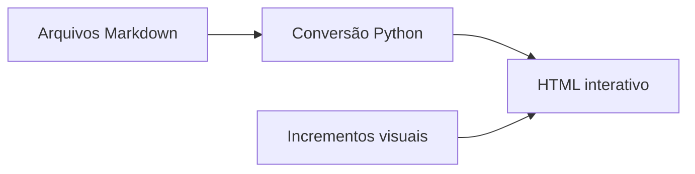

# Conversão e recursos visuais

Kind: technology. Um fluxo determinístico com espaço para incrementos úteis.

Part of [PLAN.md](PLAN.md).

## Fluxo de conversão

O gerador lê o plano, resolve os documentos e monta a interface. A especificação de incrementos adiciona apenas os visuais que ajudam a explicar o conteúdo.



As conexões representam o fluxo descrito acima. O [mapa de leitura](PLAN.md#partes) representa os links documentais.

## Tipos de entrada

A tabela demonstra um gráfico construído com valores explícitos do próprio documento. Estes números representam quantos tipos de entrada estão listados em cada grupo desta demonstração.

| Grupo | Tipos | O que inclui |
| --- | ---: | --- |
| Texto | 2 | Markdown principal e Markdown filho |
| Imagens | 3 | PNG, JPEG e SVG neste exemplo |
| Incrementos | 4 | Mermaid, gráfico de tabela, linha do tempo e imagem |

O gerador aceita outros formatos de imagem além dos escolhidos para esta tabela.

## Rastreabilidade

Cada documento tem seu hash de origem no manifesto de construção. Os links entre arquivos são convertidos em atalhos para as seções correspondentes; os incrementos visuais incluem suas referências.

O conteúdo permanece rastreável até o arquivo de origem, inclusive quando dois documentos usam o mesmo título de seção.[^origem]

```powershell
python scripts/plan_html.py scan examples/reading-plan --output outline.json
python scripts/plan_html.py build examples/reading-plan --output plan.html
```

[^origem]: Os identificadores das seções incluem o documento para evitar colisões.

## Checklist da demonstração

- [x] Escrever um plano com documentos conectados.
- [x] Incluir referências visuais e um diagrama.
- [ ] Revisar o plano com a equipe.

Este checklist registra itens do exemplo; ele não representa aceitação de funcionalidades de um projeto.
