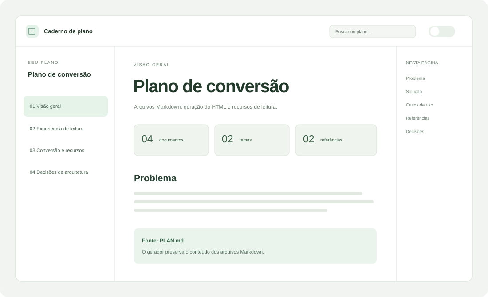

# Visualização de planos em HTML

## Problema

Planos divididos em vários arquivos Markdown dificultam a consulta de seções, decisões e imagens de referência.

## Solução

Gerar um HTML com navegação, busca, imagens e diagramas, preservando o conteúdo e os links dos arquivos Markdown.

Os agentes usam o Markdown como fonte. O HTML permite consultar e apresentar o plano.

## Casos de uso

1. Como leitor, quero percorrer o plano em uma sequência clara, para entender primeiro o contexto e depois os detalhes.
2. Como responsável pelo projeto, quero encontrar uma decisão pela busca, para retomar rapidamente o raciocínio que a fundamentou.
3. Como agente, quero reconstruir a interface por comando, para evitar reescrever o conteúdo a cada mudança.
4. Como apresentador, quero ampliar as referências e os diagramas, para explicar o plano com mais clareza.

## Interface e referências

Uma superfície de leitura com navegação lateral, hierarquia editorial e controles discretos. A referência abaixo ilustra a organização proposta.

Consulte os detalhes em [A experiência de leitura](01-experiencia.md#navegação-e-orientação).

## Decisões

**Confirmado:** preservar a fonte Markdown, converter por código e manter os incrementos visuais em um arquivo independente. Consulte [ADR-1](03-decisoes.md#adr-1-markdown-como-fonte).

**Confirmado:** disponibilizar os dois temas desde a primeira versão. Consulte [ADR-2](03-decisoes.md#adr-2-dois-temas-uma-interface).

## Como demonstrar

- Abrir este arquivo HTML localmente com a rede desativada.
- Alternar o tema e confirmar que o diagrama acompanha a mudança.
- Buscar por “rastreabilidade” e navegar ao resultado.
- Abrir a imagem de referência pelo teclado.
- Gerar o HTML novamente e comparar os hashes.

## Fora de escopo

Publicar automaticamente o plano, converter a leitura em um editor de projetos ou transformar contagens de itens em percentual de implementação.

## Partes

- [01-experiencia.md](01-experiencia.md): spec: navegação, leitura e acessibilidade.
- [02-conversao.md](02-conversao.md): technology: conversão, gráficos e rastreabilidade.
- [03-decisoes.md](03-decisoes.md): decisions: escolhas de arquitetura e seus motivos.
